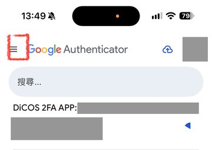
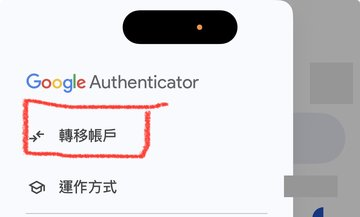
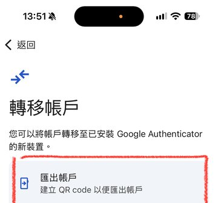
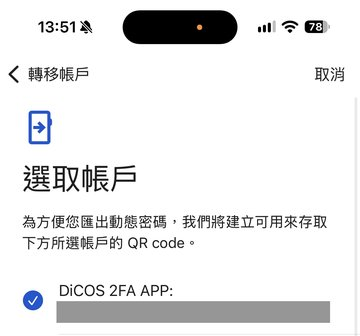

# dicos

CLI for running Slurm jobs on ASGC DiCOS (`slurm-ui.twgrid.org`) from a laptop. Verbs mirror `lab`.

## Requirements

- SSH access from an allow-listed source IP. Usually a lab server alias in `~/.ssh/config` (key auth) used as ProxyJump.
- A DiCOS account with Google Authenticator 2FA: password plus TOTP secret (secret, `otpauth://` URI, Google Authenticator export URI, or a QR image of any of these).
- `ssh`, `rsync`, `git`, and [uv](https://docs.astral.sh/uv) locally.

## Install

```bash
uvx --from git+https://github.com/novis10813/dicos dicos --help   # one-off
uv tool install git+https://github.com/novis10813/dicos           # persistent; later: dicos update
```

## Agent skill installation

Install the [dicos-cli skill](skills/dicos-cli/SKILL.md) (operator guide for coding agents) with [skills](https://github.com/vercel-labs/skills):

```bash
npx skills add novis10813/dicos --skill dicos-cli -g          # pick agents interactively
npx skills add novis10813/dicos --skill dicos-cli -g -a pi    # one agent, e.g. Pi
```

This installs agent instructions only, not the `dicos` executable. Install `dicos` with the uv command above.

## Setup

```bash
dicos init      # username, TOTP, password, jump host, first login, remote workdir
dicos doctor    # verify files, jump host, login, sinfo, account, workdir, GitHub
```

### TOTP secret from Google Authenticator

`dicos init` needs the TOTP secret, which the app does not show directly. Export it as a QR code:

1. Tap the menu (≡).
2. Tap **Transfer accounts** (轉移帳戶).
3. Tap **Export accounts** (匯出帳戶).
4. Select only the DiCOS account and tap **Next**. The app shows a QR code.

<p>




</p>

Get that QR code onto your laptop as an image (a screenshot sent to yourself, or a photo of the screen). Run `dicos init`, leave the `TOTP secret or URI` prompt empty, and enter the image path (or pass `--qr PATH`). If the app offers to remove the exported account from the phone, keep it. `init` prints the current code; check that it matches the app.

The QR image is your second factor. Delete it after `init`, and never commit it or paste it into a chat with an agent.

`init` probes every `~/.ssh/config` Host alias (and a direct connection) for reachability of `slurm-ui.twgrid.org:22`, prints the current TOTP for comparison with your app, opens the SSH master, and picks `/ceph/work/<group>/<user>/dicos` (fallback `$HOME/dicos`). Scriptable: `--user`, `--jump ALIAS|--no-jump`, `--qr PATH`, `--password-stdin`, `--totp-secret-stdin` (password line first), `--force`.

## Safety

- More than 5 failed logins ban the source IP, which is the shared jump host. dicos never retries a login.
- After a failed login, dicos writes `~/.dicos/login.failed` and refuses further attempts. Fix the cause, then run `dicos init --force` (new credentials) or `dicos logout` (allows one new attempt).
- `~/.dicos` is mode 0700 and every file 0600. Credentials refuse to load with looser modes. No OS keyring.
- One SSH ControlMaster (`~/.dicos/cm.sock`, 8 h) performs 2FA. Every other command reuses it.
- Remote `$HOME` is temporary NFS. Job data lives under the persistent workdir.

Partition names are not uniform (`a100-al9`, `a100_short-al9`, `a100_devel-al9`, `v100-al9_short`). Run `dicos status` for the exact names your account can use.

## Commands

| Command | Purpose |
|---|---|
| `init`, `doctor`, `code`, `logout` | Setup, health check, print current TOTP, close master |
| `status [--all]` | Partitions your account may use (`--all`: every partition) |
| `run [-p P] [--gpus N] [--cpus N] [--mem 32G] [-t 6h] [--sync] [--branch/--commit/--tag] -- CMD` | Submit one job |
| `sweep FILE.yaml [same flags]` | Submit one Slurm array job, one record per grid point |
| `list [-s STATUS] [--all]`, `show ID` | Refresh and inspect jobs |
| `logs ID [-n 200] [-f]` | Tail the job log |
| `fetch ID PATH... [-o DEST]` | Copy outputs (paths relative to the job's `src/`, or absolute) to `./<ID>/` |
| `wait ID [--timeout S] [--interval 15]` | Exit 0 succeeded, 1 failed, 2 cancelled, 3 lost, 124 timeout |
| `stop ID`, `clean ID [-y]` | Cancel, remove the remote job directory of a finished job |
| `ssh`, `exec -- CMD` | Shell or command on the login node |
| `update [--check]` | Reinstall from the git source via `uv tool install` |
| `feedback [TITLE] [--body TEXT]` | Open a GitHub issue with `gh` |

Time accepts `30m`, `6h`, `2d`, `1d12h`, or raw Slurm format. Defaults for `partition`, `time`, `gpus`, `cpus`, `mem` can be set under `defaults:` in `~/.dicos/config.yaml`; `dicos init` asks for the default partition and time (or `--default-partition`, `--default-time`). Per-project `setup:` replaces the default setup (install uv if missing, `uv sync` when `pyproject.toml` exists).

## Examples

```bash
# Git mode (default): HEAD must be clean and pushed; the login node clones it with your forwarded ssh-agent.
dicos run -p a100-al9 --gpus 1 -t 6h -- python train.py --epochs 10
dicos run -p a100_devel-al9 --gpus 1 -t 10m -- nvidia-smi   # 20 min limit, for quick checks
dicos run -p a100-al9 --gpus 1 --branch exp -- python train.py

# Sync mode: rsync the working tree (honours .gitignore, skips .git/.venv).
dicos run --sync -p edr1-al9_short_serial -t 10m -- python3 check.py

dicos logs train-3 -f
dicos fetch train-3 checkpoints/ metrics.json   # -> ./train-3/
dicos wait train-3 --timeout 3600 && echo done
dicos clean train-3 -y
```

Sweep file:

```yaml
command: python train.py --lr {lr} --seed {seed}
grid:
  lr: [0.1, 0.01]
  seed: [1, 2, 3]
partition: a100-al9   # optional: partition, gpus, cpus, mem, time (flags override)
gpus: 1
time: 6h
```

```bash
dicos sweep sweep.yaml          # 6 records, one array job; logs read output_<i>.log
```
